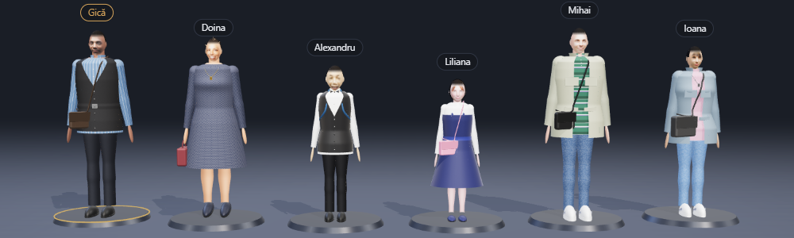
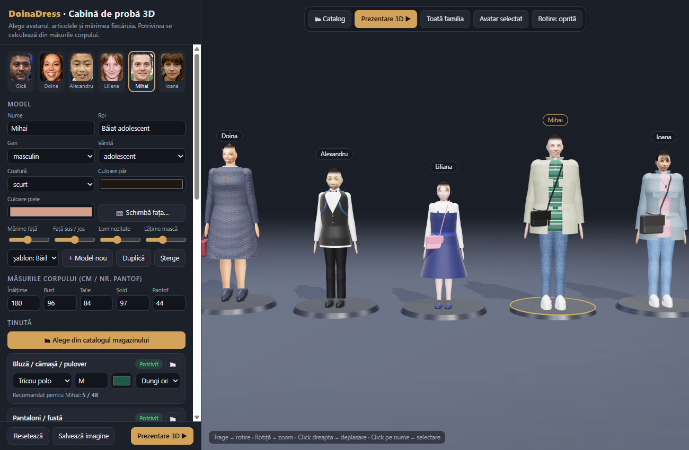
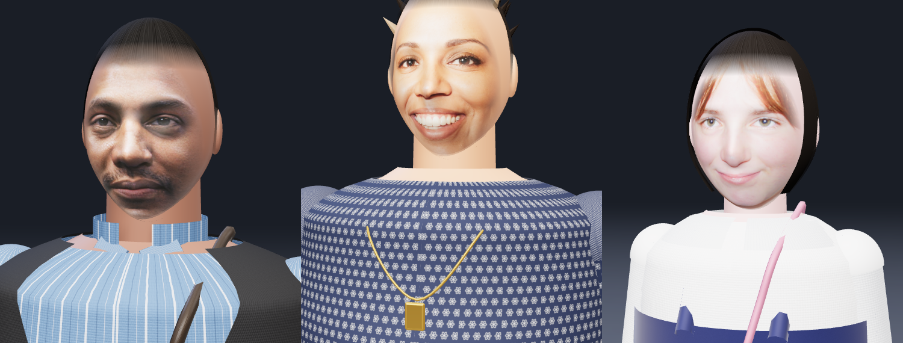
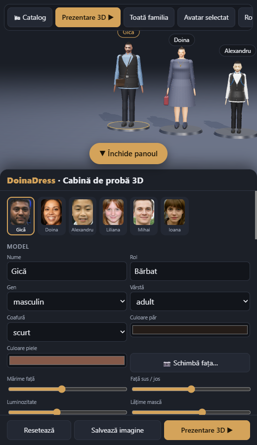
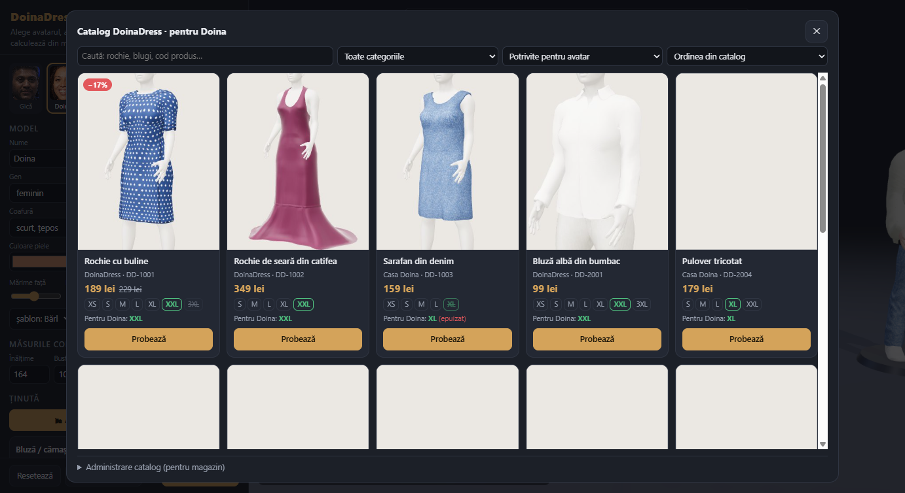
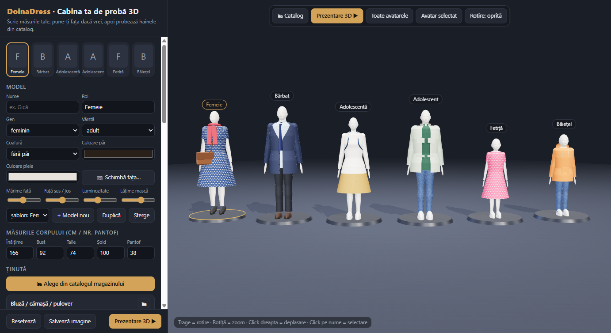
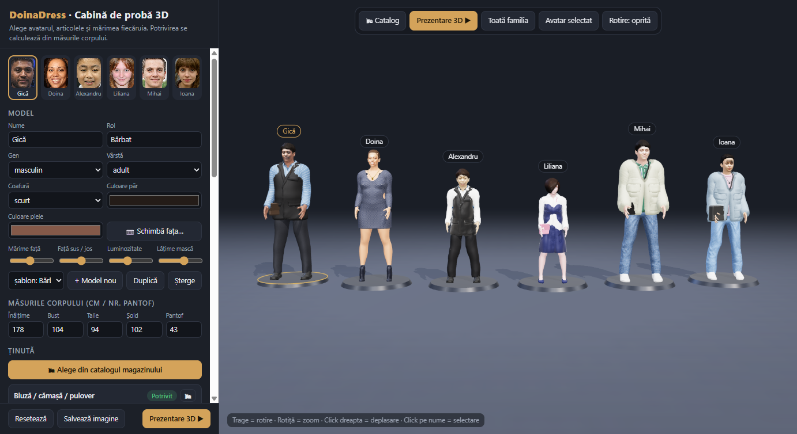
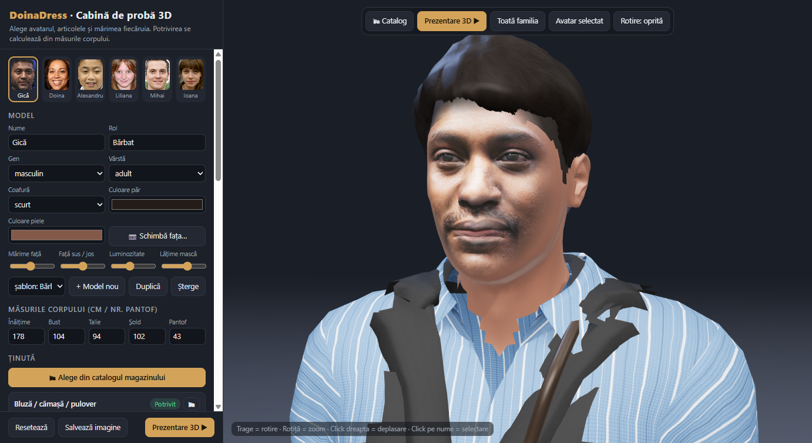

# 1. Ce este și ce fișiere are

**DoinaDress Cabina 3D** este o pagină web care afișează avataruri 3D (bărbat, femeie, copii, adolescenți) cu fețele din fotografii. Pe ele probezi haine, încălțăminte, genți și accesorii, pe mărimi reale. Aplicația calculează dacă articolul se potrivește și apoi prezintă familia îmbrăcată, într-un tur 3D.



| Fișier / folder | Rol |
|---|---|
| `DoinaDress_Cabina3D.html` | **Aplicația.** Un singur fișier, cu fețele incluse. Se deschide cu dublu-click. |
| `DoinaDress_Cabina3D_simplu.html` | **Varianta mică (~2,3 MB)**, cu corpul simplu de dinainte de modelele MakeHuman. Aceleași modele, catalog și funcții. |
| `DoinaDress_Simplu.apk` | **Aplicația Android mică (~16 MB)**, doar cu corpul simplu. Se instalează alături de `DoinaDress.apk` (apare ca „DoinaDress Simplu”). Se reface cu `python src/build_simplu.py`. |
| `magazin/DoinaDress_Magazin_Simplu.apk` | **Aplicația mică pentru clienți (~16 MB)**, cu manechine și corpul simplu („DoinaDress Magazin Simplu”). Se reface cu `python src/build_simplu.py --clienti`. |
| `kotlin_apk/` | **Aplicațiile Android native (Kotlin)**, de 0,5–15 MB, toate cele 4 variante. Vezi capitolul 15. |
| `modele/baza_modele.json` | **Baza de modele pe disc:** nume, rol, măsuri, ținute, fețe, reglaje. |
| `fete/*.jpg` | Fețele aliniate (1024 × 1280 px), câte una pentru fiecare model. |
| `catalog/catalog.json` | **Catalogul magazinului:** produse, prețuri, stoc pe mărimi, tabelele de mărimi ale mărcilor. |
| `catalog/poze/` | Pozele produselor folosite de `catalog.json`. |
| `catalog/model_import.csv` | Model de tabel pentru importul produselor din Excel. |
| `modele/baza_clienti.json` | Avatarele-manechin ale versiunii pentru clienți (fără poze). |
| `src/mh_download.py`, `src/mh_build.py`, `src/mh_runtime.js` | Corpul 3D realist (MakeHuman, CC0): descărcarea resurselor, construirea pachetului, codul din aplicație. |
| `build_cache/mh.pack` | Pachetul 3D realist (~14 MB): corp, ținte de deformare, 29 de haine, 10 coafuri. Se reface cu `mh_build.py`. |
| `magazin/` | **Versiunea pentru clienți:** `DoinaDress_Magazin.html`, `web/` (PWA) și `DoinaDress_Magazin.apk`. |
| `src/fete.py` | Unealtă: aliniază o față după ochi, creează grila de coordonate, adaugă modele. |
| `src/build.py` | Construiește `DoinaDress_Cabina3D.html` din șablon, bază și fețe. |
| `src/cabina3d.template.html` | Codul sursă al aplicației. |
| `src/vendor/` | Biblioteca 3D (three.js), inclusă local: aplicația merge **fără internet**. |
| `web/` | Aceeași aplicație ca **PWA**, instalabilă pe Android și iPhone dintr-un browser. |
| `DoinaDress.apk` | **Aplicația Android**, gata de instalat pe telefon. |
| `mobile/` | Proiectul aplicației native (Flutter), pentru Android și iPhone. |
| `poze_generice/` | Fotografiile-sursă ale fețelor: fețe generate de AI, persoane care nu există (domeniu public). Sursele și licențele sunt în `poze_generice/SURSE.md`. |

> Aplicația **nu are nevoie de internet**: biblioteca 3D și fețele sunt incluse în fișier. Fotografiile **nu** se trimit nicăieri; totul rămâne pe calculatorul sau telefonul tău.

# 2. Pornire rapidă

1. Dublu-click pe `DoinaDress_Cabina3D.html`. Se deschide în Chrome sau Edge.
2. Sus, în panoul din stânga, alegi modelul (miniaturile cu fețe).
3. La **Ținută** alegi articolul, mărimea, culoarea și modelul țesăturii.
4. Butonul **Prezentare 3D ▶** pornește turul automat. Tasta `Esc` îl oprește.

Pe telefon (Android sau iPhone) vezi **capitolul 11**.

Comenzi în scenă: **trage** = rotire, **rotița** = zoom, **click dreapta + trage** = deplasare, **click pe numele de deasupra capului** = selectare.

Linkuri directe (adaugi la finalul adresei):

| Adaugi | Efect |
|---|---|
| `#barbat` | deschide direct modelul cu id-ul `barbat` (tot corpul) |
| `#barbat-fata` | prim-plan pe fața modelului |
| `#prezentare` | pornește direct turul 3D |

# 3. Modelele inițiale și numele lor

| Id (intern) | Rol | Nume | Fotografie-sursă |
|---|---|---|---|
| `barbat` | Bărbat | **Gică** | poze_generice/barbat.jpg |
| `femeie` | Femeie | **Doina** | poze_generice/femeie.jpg |
| `baietel` | Băiețel | **Alexandru** | poze_generice/baietel.jpg |
| `fetita` | Fetiță | **Liliana** | poze_generice/fetita.jpg |
| `baiat_ado` | Băiat adolescent | **Mihai** | poze_generice/baiat_ado.jpg |
| `fata_ado` | Fată adolescentă | **Ioana** | poze_generice/fata_ado.jpg |

**Ca să schimbi un nume:** selectezi modelul și scrii în câmpul **Nume** din secțiunea **Model**. Se salvează imediat. Eticheta de deasupra capului, miniatura și fișa din prezentare se actualizează singure.

**Rol** este categoria (Bărbat, Bunică, Nepot…). **Gen** și **Vârstă** (adult / adolescent / copil) stabilesc proporțiile corpului și tabelul de mărimi.

# 4. Îmbrăcarea: mărimi și potrivire



Fiecare model are **măsurile corpului**: înălțime, bust, talie, șold și numărul de pantof. Valorile pornesc de la o estimare făcută din poze. Corectează-le cu măsurile reale, ca potrivirea să fie corectă.

## 4.1 Ce scrii la mărime

| Exemplu | Înțeles |
|---|---|
| `S`, `M`, `L`, `XL`, `XXL`, `3XL` | mărimi internaționale (separat pentru bărbați și femei) |
| `38`, `46`, `52` | mărimi europene numerice |
| `W33L32` sau `W33` | blugi: talia (W) și lungimea (L), în inch |
| `134`, `146`, `164` | copii: mărimea după înălțime, în cm |
| `9` (copil) | copii: mărimea după vârstă, în ani |
| `38`, `43.5` (la încălțăminte) | număr european de pantof |
| `S`, `M`, `L` (la geantă) | dimensiunea genții |

Sub fiecare articol apare **mărimea recomandată** pentru modelul selectat.

## 4.2 Eticheta de potrivire

Mărimea se compară cu bustul (pentru bluze, rochii, geci) sau cu talia (pentru pantaloni și fuste):

| Etichetă | Diferență mărime − corp | Ce vezi pe avatar |
|---|---|---|
| **Prea strâmt** | sub −6 cm | haina lipită de corp |
| **Strâmt** | −6 … −2 cm | foarte ajustat |
| **Potrivit** | −2 … +5 cm | normal |
| **Lejer** | +5 … +11 cm | mai larg |
| **Prea larg** | peste +11 cm | evident prea mare, mâneci mai lungi |

La pantofi: **Prea mic**, **Potrivit**, **Ușor mare** sau **Prea mare**, după diferența de număr.

## 4.3 Ce articole există

* **Sus:** tricou, bluză (guler rotund), cămașă, tricou polo, helancă, pulover
* **Jos:** pantaloni, blugi, pantaloni scurți, fustă, fustă lungă
* **Rochie:** cu mânecă lungă sau scurtă, rochie lungă, sarafan (se poartă peste bluză)
* **Peste:** geacă, hanorac (cu glugă), vestă, sacou, palton
* **Încălțăminte:** pantofi, adidași, cizme, balerini, pantofi cu toc, sandale
* **Geantă:** de umăr, poșetă (în mână), rucsac, borsetă
* **Accesorii (două locuri):** colier cu pandantiv, papion, cravată, eșarfă, curea, ochelari, pălărie, șapcă

Țesăturile disponibile: uni, dungi verticale, dungi orizontale, reiat, carouri, dantelă, denim, catifea, buline.

# 5. Cum pui o altă față pe un avatar (metoda A, în aplicație, recomandată)



1. Selectezi modelul (de exemplu **Gică**).
2. În secțiunea **Model** apeși **📷 Schimbă fața…**
3. Apeși **Alege fișierul** și selectezi o fotografie.
4. **Mărești** pe fața persoanei: rotița mouse-ului sau butonul **＋**. Tragi cu mouse-ul ca să muți imaginea.
5. Faci **click pe ochiul din stânga imaginii**, apoi pe **ochiul din dreapta imaginii**. Dacă ai greșit, apeși **Refă punctele ochilor**.
6. În dreapta vezi previzualizarea: ochii devin automat orizontali, iar fața e scalată la standard.
7. Bifa **potrivește culoarea pielii** ia culoarea capului și a mâinilor din obrajii din poză.
8. Apeși **Folosește această față**. Camera se apropie de fața nouă.

## 5.1 Reglaje fine (glisoarele de sub „Model”)

| Glisor | Folosește-l când… |
|---|---|
| **Mărime față** | fața pare prea mică sau prea mare față de cap |
| **Față sus / jos** | ochii nu stau la mijlocul capului (de exemplu, la copii) |
| **Luminozitate** | poza e întunecată (bliț slab) sau prea luminoasă |
| **Lățime mască** | pe margini se vede fundalul sau părul din poză: micșorează masca |

## 5.2 Sfaturi pentru o față reușită

* Poza să fie **din față**. Capul întors sau aplecat produce o față deformată pe avatar; e cazul pozei actuale a lui Alexandru.
* Lumină uniformă, fără umbre tari. Ochii deschiși și vizibili amândoi.
* Fața să aibă cel puțin **150 px** între ochi în fotografia originală; ideal **400 px** (un selfie de telefon are de obicei 300–500 px). Textura feței are 1024 × 1280 px, dar nu poate adăuga detalii care lipsesc din poză: o poză mică dă o față netedă.
* Ochelarii din poză rămân pe față. Pentru ochelari 3D separați folosești accesoriul **Ochelari**.

# 6. Model nou (de exemplu „Bunica Ana”)

1. În secțiunea **Model** alegi un **șablon** din listă: Bărbat, Femeie, Băiețel, Fetiță, Băiat adolescent sau Fată adolescentă.
2. Apeși **+ Model nou**. Apare un avatar nou pe scenă, cu ținuta șablonului.
3. Completezi **Nume** (Ana) și **Rol** (Bunică) și alegi **Gen** și **Vârstă**.
4. Apeși **📷 Schimbă fața…** și urmezi pașii din capitolul 5.
5. Corectezi măsurile corpului și ținuta.

**Duplică** copiază modelul selectat, cu tot cu față și ținută. **Șterge** îl elimină din bază și cere confirmare.

# 7. Metoda B: fețe și modele direct în fișiere

Metoda B e utilă când vrei ca modelele noi să fie **incluse permanent** în fișierul `DoinaDress_Cabina3D.html`, de exemplu ca să-l trimiți altcuiva. Ai nevoie de Python 3 cu Pillow (`pip install pillow`). Comenzile se rulează din folderul `DoinaDress`.

**Pasul 1. Află coordonatele ochilor.** Comanda salvează `poze/ana_grila.png`, cu o grilă numerotată în pixeli. Citești pe ea poziția fiecărui ochi.

```
python src/fete.py grila poze/ana.jpg
python src/fete.py grila poze/ana.jpg 800 500 1200 900
```

A doua variantă face grila doar pe zona dată (X0 Y0 X1 Y1), ca să vezi mai bine.

**Pasul 2. Adaugă modelul.** Comanda aliniază fața (`fete/ana.jpg`), calculează culoarea pielii și scrie modelul în `modele/baza_modele.json`.

```
python src/fete.py adauga --id ana --rol "Bunică" --nume "Ana" --gen f --varsta adult --foto poze/ana.jpg --ochi 905 655 1012 660 --sablon femeie
```

* `--ochi X1 Y1 X2 Y2` sunt coordonatele celor doi ochi, în pixeli din poza originală.
* `--sablon` arată de la ce model se copiază măsurile și ținuta de pornire.
* Dacă `--id` există deja, modelul se **actualizează**: primește față nouă și nume nou.

**Pasul 3. Reconstruiește aplicația.**

```
python src/build.py
```

**Alte operații pe disc:**

* Ca să schimbi doar un nume, editezi `"nume"` în `modele/baza_modele.json` și rulezi `python src/build.py`.
* Ca să refaci toate fețele din fotografii, după ce ai corectat coordonatele `"ochi"` din bază, rulezi `python src/fete.py toate`.

# 8. Baza de modele: salvare, export, import, upgrade

## 8.1 Unde se salvează

* Orice modificare făcută în aplicație se **salvează automat în browser** (IndexedDB): nume, fețe, măsuri, ținute, modele noi.
* Rândul de stare de sub **Baza de modele** arată numărul de modele, schema, revizia și ora ultimei salvări.
* Salvarea e legată de **browser și de calculator**. În alt browser sau pe alt PC pornești de la baza inițială, până imporți baza ta.

## 8.2 Butoanele

| Buton | Ce face |
|---|---|
| **⬇ Exportă baza** | Descarcă `baza_modele_AAAA-LL-ZZ.json`, cu toate modelele și fețele incluse. Este copia ta de siguranță. Pe telefon se deschide meniul **Partajează**: salvezi în Fișiere sau Drive, ori trimiți pe e-mail sau WhatsApp. |
| **⬆ Importă / actualizează** | Încarcă un fișier exportat. Modelele cu același id sunt **actualizate**, cele noi sunt **adăugate**. Nimic nu se șterge. |
| **Revino la baza inițială** | Șterge modificările din browser și revine la modelele din fișierul HTML. Exportă baza înainte! |
| **Resetează** (jos) | Readuce doar măsurile și ținuta modelului selectat la valorile inițiale. |

## 8.3 Cum se face upgrade

Baza are trei elemente care permit actualizarea fără pierderi:

1. **Schema.** Este versiunea formatului (acum **2**). Când se deschide o bază mai veche, de exemplu un export vechi, aplicația o **migrează automat** la formatul nou și completează câmpurile lipsă cu valori implicite. Salvările din prima versiune a aplicației sunt preluate automat.
2. **Revizia.** Fiecare rulare `python src/build.py` dă bazei din HTML o revizie nouă, de forma AAAALLZZOOMM. Când deschizi un HTML mai nou, aplicația:
   * **adaugă** modelele noi din HTML;
   * **înlocuiește** modelele pe care nu le-ai modificat în browser;
   * **păstrează** modelele pe care le-ai modificat tu.
3. **Exportul și importul** mută baza între calculatoare și browsere.

**Cum faci din modificările tale noua bază „oficială”**, inclusă în fișierul HTML:

1. În aplicație apeși **⬇ Exportă baza**.
2. Copiezi fișierul exportat peste `modele/baza_modele.json`. Fețele sunt deja incluse în el, deci nu trebuie copiate separat.
3. Rulezi `python src/build.py`.
4. Noul `DoinaDress_Cabina3D.html` conține toate modelele și se poate trimite oricui.

# 9. Prezentarea 3D și capturi

* **Prezentare 3D ▶** face întâi o rotire în jurul întregii familii. Apoi trece la fiecare model: avatarul se rotește 360°, iar fișa din dreapta jos arată articolele, mărimile și potrivirea. La final reia turul.
* **Toată familia** arată vederea de ansamblu. **Avatar selectat** apropie camera de modelul ales. **Rotire** rotește continuu modelul selectat.
* **Salvează imagine** descarcă un PNG cu vederea curentă.

## 9.1 Calitatea imaginii

În panou, la **Afișare → Calitate imagine**:

| Setare | Ce face |
|---|---|
| **Automată** (recomandat) | Pornește la rezoluția cea mai mare. Dacă dispozitivul nu ține pasul (sub ~40 de cadre pe secundă), coboară rezoluția, apoi o urcă la loc când poate. |
| **Înaltă** | Rezoluție maximă (pe calculator, imaginea se desenează de 1,5× mai fin decât ecranul) și umbre detaliate. Pentru capturi și prezentări. |
| **Medie** | Compromis pentru telefoane mai vechi. |
| **Economică** | Rezoluție de bază; economisește bateria. |

Lângă setare apare rezoluția reală a imaginii. Alegerea se păstrează pe fiecare dispozitiv. Pentru un fișier mic, doar cu corpul simplu, folosește `DoinaDress_Cabina3D_simplu.html` (~2,3 MB, creat automat de `python src/build.py`; la clienți: `magazin/DoinaDress_Magazin_simplu.html`).

Scena se desenează **doar când se mișcă ceva** (rotire, prezentare, schimbarea unei haine). Cât timp nu atingi nimic, telefonul nu consumă baterie pentru 3D.

Materialele au **relief**: pânza are fire, puloverul are ochiuri tricotate, blugii au diagonala denimului, reiatul are dungi în relief, iar pielea pantofilor și a genților are pori. Relieful se alege singur după tipul articolului și după model.

# 10. Probleme frecvente

| Problemă | Soluție |
|---|---|
| Pagina rămâne neagră | Folosește un browser actual (Chrome, Edge, Safari, Firefox) cu WebGL activat. |
| Pe Android, APK-ul nu se instalează | Permite „Instalare din surse necunoscute” pentru aplicația cu care ai deschis fișierul (Fișiere, Chrome). |
| Pe telefon totul e mic sau încet | Alege **Afișare → Calitate imagine → Medie** sau **Economică**. Închide alte aplicații. |
| Fața e „topită” sau deformată | Poza nu e din față. Alege altă poză sau micșorează **Lățime mască**. |
| Se vede fundal lângă obraz | Micșorează **Lățime mască**. |
| Fața e prea închisă sau prea deschisă | Folosește glisorul **Luminozitate**. Pielea corpului se ajustează odată cu ea. |
| Modificările au dispărut | Ai deschis alt browser sau ai șters datele site-ului. Folosește **⬆ Importă** cu ultimul export. |
| Mesaj roșu „⚠ …” jos, în stânga | O eroare internă. Notează textul și reîncarcă pagina. Datele salvate nu se pierd. |

# 11. Pe telefon: Android și iPhone

{width=45%}

Aplicația are interfață de telefon:

* Scena 3D ocupă tot ecranul.
* Butonul **☰ Model și ținută** (jos) deschide panoul ca o foaie glisantă, iar avatarul rămâne vizibil deasupra.
* Rotești scena cu un deget, faci zoom cu două degete și o deplasezi cu două degete.
* În fereastra **Schimbă fața**: mărești cu două degete și atingi cei doi ochi.
* Pe Android, butonul **Înapoi** închide pe rând fereastra deschisă, panoul și prezentarea.

## 11.1 Android: aplicația `DoinaDress.apk` (recomandat)

1. Copiezi `DoinaDress.apk` pe telefon: prin cablu USB, Google Drive sau e-mail către tine.
2. Deschizi fișierul pe telefon și apeși **Instalează**. Dacă telefonul cere, permiți **instalarea din surse necunoscute** pentru aplicația cu care l-ai deschis.
3. Pornești **DoinaDress** din lista de aplicații. Merge **fără internet**.
4. **Schimbă fața…** deschide galeria telefonului. **Exportă baza** și **Salvează imagine** deschid meniul de partajare.
5. Modelele, fețele și ținutele se salvează **în aplicație** și rămân după repornire. Pentru siguranță, exportă baza din când în când.

## 11.2 iPhone

Apple nu permite instalarea aplicațiilor din fișiere, ca pe Android. Există două variante.

**Varianta 1, PWA (fără Mac).** Aplicația se instalează din Safari:

1. Pui conținutul folderului `web/` pe un server **HTTPS**. Poate fi site-ul magazinului, un hosting sau un NAS cu certificat. Dacă înlocuiești fețele cu poze reale, folosește o adresă protejată cu parolă sau privată, pentru că pozele sunt incluse în aplicație.
2. Pe iPhone deschizi adresa în **Safari**, apeși **Partajează** și apoi **Adaugă pe ecranul principal**.
3. Apare iconița **DoinaDress**. Aplicația pornește pe tot ecranul și merge și **fără internet** după prima deschidere.

Aceeași metodă funcționează și pe Android, cu Chrome → meniul ⋮ → **Instalează aplicația**.

**Varianta 2, aplicație nativă iOS (necesită un Mac cu Xcode).** Proiectul este deja pregătit în `mobile/`:

```
cd mobile
flutter pub get
open ios/Runner.xcworkspace
```

În Xcode alegi **Signing & Capabilities**, apoi **Team** (contul Apple ID), conectezi iPhone-ul și apeși **Run**. Cu un Apple ID gratuit, aplicația rulează 7 zile; cu contul Apple Developer (99 $/an) funcționează permanent și poate fi distribuită prin TestFlight sau App Store.

## 11.3 După modificări: reconstruirea aplicațiilor

Ca telefoanele să primească modelele noi, după ce modifici baza pe disc sau codul:

```
python src/build.py
cd mobile
flutter build apk --release
```

* Pentru corpul realist, `build_cache/mh.pack` trebuie să existe (capitolul 14.3); altfel aplicația folosește corpul simplu.
* `python src/build.py` actualizează `DoinaDress_Cabina3D.html`, folderul `web/` și resursele aplicației.
* `flutter build apk --release` creează noul APK în `mobile/build/app/outputs/flutter-apk/app-release.apk`; îl copiezi peste `DoinaDress.apk` și îl reinstalezi pe telefon.
* La reinstalare, modelele salvate în telefon **rămân**. Modelele noi din build sunt adăugate automat (vezi 8.3).
* Pentru PWA, urci din nou conținutul folderului `web/` pe server; telefoanele preiau automat versiunea nouă la următoarea deschidere cu internet.

# 12. Catalogul magazinului

Catalogul leagă cabina de probă de produsele reale ale magazinului. Clientul alege un produs, îl vede pe avatarul lui, primește mărimea recomandată după tabelul mărcii și trimite lista de cumpărături.



## 12.1 Pentru client: probă, mărime, coș

1. Apasă **🛍 Catalog** (sus) sau **🛍 Alege din catalogul magazinului** (în panou, la Ținută). Butonul 🛍 de pe fiecare articol deschide catalogul direct la categoria lui.
2. Catalogul arată implicit produsele **potrivite pentru avatarul ales** (femei, bărbați sau copii). Poți căuta după nume sau cod, filtra pe categorii și sorta după preț.
3. Fiecare produs arată prețul (și reducerea, dacă există), mărimile cu stoc (cele **tăiate** sunt epuizate) și **mărimea recomandată**, marcată cu verde.
4. **Probează** îmbracă avatarul cu produsul, în mărimea recomandată.
5. În panou, articolul apare cu poza, marca și prețul. Mărimea se alege dintr-o listă cu mărimile disponibile.
6. **⇆ Compară mărimi** pune alături același avatar în altă mărime. În bara de jos alegi mărimea din dreapta și vezi potrivirea fiecăreia; **Aleg …** păstrează mărimea din dreapta.
7. Secțiunea **Coș** din panou adună produsele de pe avatar și totalul. **📤 Trimite lista** deschide WhatsApp, e-mail sau SMS pe telefon; pe calculator, lista se copiază și o poți lipi oriunde. **Lista pentru toată familia** include produsele tuturor avatarelor.

**Cum se alege mărimea.** Dacă produsul are un **tabel de mărimi**, aplicația caută mărimea al cărei interval conține măsura avatarului: bust pentru bluze și rochii, talie pentru pantaloni și fuste, înălțimea pentru copii. Fără tabel, folosește mărimile standard din capitolul 4 și alege mărimea disponibilă cu potrivirea cea mai bună. La încălțăminte compară numărul cu „Pantof” din măsurile corpului.

## 12.2 Pentru magazin: produse, poze, stoc

Deschide catalogul și apasă **Administrare catalog (pentru magazin)**, jos. Pe fiecare produs apare butonul **✎** (editare).

**+ Produs nou** sau **✎** deschide fișa produsului:

| Câmp | Ce scrii |
|---|---|
| Nume, Cod produs, Marcă | Cum apar în catalog și pe lista de cumpărături. Codul servește și la actualizarea din CSV. |
| Categorie, Tip (forma 3D) | Categoria din catalog și forma hainei pe avatar (ex. Rochii → Rochie mânecă scurtă). |
| Pentru | Femei, Bărbați, Copii (oricâte). Decide pe ce avatare apare produsul în catalog. |
| Preț, Preț vechi | Prețul vechi, dacă e mai mare, afișează reducerea (ex. −17%). |
| Culoare, Model material | Culoarea și desenul (uni, dungi, carouri, denim, buline…). |
| Mărimi și stoc | `S:3, M:5, L:0` – mărimea și bucățile în stoc; 0 = epuizat (se poate proba, dar e marcat). |
| Tabel de mărimi | Tabelul mărcii folosit pentru recomandare (vezi 12.3). |
| Poză | Fotografia produsului. Fără poză, catalogul generează singur o imagine 3D pe un manechin. **Culoare din poză** ia culoarea dominantă a produsului. |

**Imprimeul real pe haina 3D.** La *Model material* alege **Desen din poză**, apoi trage cu mouse-ul sau cu degetul un dreptunghi peste o zonă de material fără cute și umbre. Zona se repetă pe haina 3D. La **Mărimea desenului pe haină (cm)** scrii cât măsoară, în realitate, zona aleasă (ex. 12 cm), ca florile să aibă mărimea corectă pe avatar.

## 12.3 Tabelele de mărimi ale mărcilor

În **Administrare catalog**, tabelele se scriu ca text simplu:

```
[dd_femei_sus] DoinaDress femei – bluze, rochii · bust
XS 78-82
S 82-86
M 86-90
```

* Primul rând: `[id]`, numele tabelului, `·` și măsura: `bust`, `talie`, `sold`, `pantof` sau `inaltime`.
* Apoi câte un rând pentru fiecare mărime: `mărime min-max`, în centimetri (sau număr de pantof).
* **Salvează tabelele** verifică textul și arată rândul greșit, dacă există.

Catalogul de pornire are tabele pentru femei (sus și jos), bărbați (sus și jos, mărimi EU), blugi (W30–W38) și copii (după înălțime, 104–164).

## 12.4 Import din Excel (CSV) și export

1. În Excel completezi un tabel cu coloanele din `catalog/model_import.csv`:
   `cod; nume; marca; categorie; tip; pentru; pret; pret_vechi; culoare; model; marimi; tabel; poza; desen_cm; descriere`.
2. **Salvează ca** → *CSV UTF-8 (delimitat prin virgulă)*. Separatorul poate fi `;` sau `,`.
3. **⬆ Importă CSV / JSON + poze**: selectezi **împreună** fișierul CSV și pozele produselor. Pozele se potrivesc după numele din coloana `poza`.

Reguli pentru coloane:

* `categorie`: rochii, bluze, pantaloni, fuste, geci, incaltaminte, genti, accesorii (sau cuvintele din aplicație).
* `tip`: numele din aplicație (ex. „Cămașă”, „Blugi”, „Pantofi cu toc”).
* `pentru`: femei, barbati, copii, unisex; mai multe se despart cu `|`.
* `marimi`: `S:2|M:4|L:3`.
* `culoare`: cod (`#2f6fb0`) sau nume (alb, negru, rosu, albastru, bleumarin, verde, bej, maro, roz…).
* `model`: uni, dungi, carouri, denim, buline… sau `desen`. Cu `desen` și `desen_cm`, centrul pozei devine imprimeul hainei 3D.
* Produsele cu un **cod** existent se **actualizează** (preț, stoc etc.); cele noi se adaugă.
* Doar poze, fără CSV: pozele numite după cod (ex. `DD-1001.jpg`) se pun pe produsele respective.

**⬇ Exportă catalog (JSON)** salvează tot catalogul, cu poze și tabele. Pus în `catalog/catalog.json`, devine catalogul inclus în aplicație la următorul `python src/build.py`. **⬇ Exportă CSV** creează tabelul pentru Excel (fără poze).

Catalogul editat în aplicație se salvează automat în browser sau telefon, separat de baza de modele. Upgrade-ul funcționează ca la modele (8.3): produsele noi din build se adaugă, cele nemodificate se actualizează, iar cele editate în magazin se păstrează. **Revino la catalogul inițial** renunță la modificările locale.

> **Pentru clienți** folosește versiunea din capitolul 13: are manechine în loc de pozele familiei.

# 13. Versiunea pentru clienți (manechine)

Aplicația are două variante, construite din același cod:

| | Versiunea internă | Versiunea pentru clienți |
|---|---|---|
| Fișiere | `DoinaDress_Cabina3D.html`, `web/`, `DoinaDress.apk` | `magazin/DoinaDress_Magazin.html`, `magazin/web/`, `magazin/DoinaDress_Magazin.apk` |
| Avatare | familia (Gică, Doina, Alexandru, Liliana, Mihai, Ioana), cu fețele din poze | 6 **manechine** fără față: Femeie, Bărbat, Adolescentă, Adolescent, Fetiță, Băiețel |
| Administrare catalog | da (produse, prețuri, stoc, tabele, import CSV) | **nu**: clientul doar probează și trimite lista |
| Nume pe telefon | DoinaDress | DoinaDress Magazin |

Versiunea pentru clienți **nu conține nicio poză a familiei**. Cele două aplicații Android se pot instala împreună pe același telefon și își păstrează datele separat.



## 13.1 Ce face clientul

1. La prima pornire apare un mic ghid: alege avatarul, scrie măsurile, pune fața (opțional), probează din catalog.
2. Alege manechinul potrivit și își scrie **măsurile** la *Măsurile corpului*. Mărimile recomandate se recalculează imediat.
3. Opțional, **📷 Schimbă fața**: își pune fața dintr-o poză (capitolul 5). Manechinul primește automat o coafură, culoarea părului din poză și culoarea pielii; toate se pot schimba la *Model*.
4. Probează produse din **🛍 Catalog**, compară mărimi și trimite **lista de cumpărături** magazinului (WhatsApp, e-mail).

Poza și măsurile clientului rămân **doar pe telefonul sau calculatorul lui**: aplicația nu are server și nu trimite nimic.

## 13.2 Construirea și distribuirea

```
python src/build.py --clienti        # magazin/DoinaDress_Magazin.html + magazin/web/
python src/build_magazin.py          # plus aplicația Android magazin/DoinaDress_Magazin.apk
```

* `build_magazin.py` construiește APK-ul pentru clienți și apoi reface resursele aplicației interne, așa că `flutter build apk --release` produce în continuare versiunea familiei.
* Manechinele și ținutele lor de pornire sunt în `modele/baza_clienti.json`. Le poți îmbrăca altfel: modifică ținutele în versiunea internă, exportă baza și copiază ținutele în acest fișier. Catalogul e același cu cel din versiunea internă (`catalog/catalog.json`).
* Distribuire: `DoinaDress_Magazin.html` se poate trimite direct; `magazin/web/` se pune pe site-ul magazinului (HTTPS) și se instalează din browser pe Android și iPhone (capitolul 11.2); APK-ul se dă clienților cu Android. Pentru Google Play sau App Store e nevoie de semnarea aplicației cu cheia magazinului și de un cont de dezvoltator.

# 14. Corpul 3D realist

Avatarele folosesc un **corp uman realist** (MakeHuman), deformat după măsurile fiecăruia, cu **haine modelate 3D** și **păr real**. Corpul simplu de dinainte rămâne disponibil.



## 14.1 Ce se schimbă

* **Corpul** pornește de la un model uman complet (cap, mâini, degete) și se deformează după gen, vârstă (adult, adolescent, copil) și măsuri. Bustul, talia și șoldul se potrivesc pe centimetru, după buclele de măsurare ale MakeHuman; înălțimea, exact.
* **Hainele** sunt modele 3D reale: tricou, polo, cămașă, pulover, pantaloni, blugi, pantaloni scurți, fuste, rochii, sarafan, geacă, sacou, vestă, palton, pantofi, adidași, cizme, balerini, pantofi cu toc, sandale. Ele urmează corpul oricăror măsuri și păstrează cutele, cusăturile și tricotul originalului. Culoarea, desenul și imprimeul vin din produs sau din panou, ca înainte.
* **Mărimea contează vizual**: o haină largă stă mai departe de corp, una strâmtă se lipește de el; **⇆ Compară mărimi** arată diferența.
* **Fața din poză** se proiectează pe un cap real (nas, pomeți, bărbie), aliniată după centrele ochilor, și se estompează spre linia părului și spre urechi.
* **Coafuri noi**: pe lângă scurt, țepos, pixie, bob și lung, poți alege coadă de cal, împletitură, bob drept, scurt ondulat și afro.
* **Accesoriile** (colier, papion, cravată, eșarfă, ochelari, pălării) și **gențile** sunt cele de dinainte, așezate pe noul corp.



## 14.2 Alegerea corpului

În panou, la **Afișare → Corp 3D**:

| Setare | Când |
|---|---|
| **Realist (MakeHuman)** | Implicit. Aspect apropiat de o persoană reală. |
| **Simplu (rapid)** | Telefoane foarte vechi sau dacă vrei aspectul de dinainte. |

Alegerea se păstrează pe fiecare dispozitiv. Și pozele de catalog generate pe manechin folosesc corpul ales; manechinul poartă dedesubt un tricou și pantaloni neutri.

## 14.3 Reconstruirea pachetului 3D

Pachetul `build_cache/mh.pack` e deja construit. Îl refaci doar dacă schimbi hainele alese:

```
python src/mh_download.py     # o singură dată: ~560 MB în assets_src/ (resurse CC0)
python src/mh_build.py        # build_cache/mh.pack
python src/build.py           # aplicația, cu pachetul inclus
```

Hainele folosite și potrivirea lor cu tipurile din catalog sunt în lista `GARMENTS` din `src/mh_build.py` (de exemplu `"blugi": ("male_casualsuit02", [1], "ao", {})`) și în tabelul `MH_GARMENT` din `src/mh_runtime.js`. Pachetele CC0 de pe makehumancommunity.org au zeci de alte haine (rochii, fuste, cizme) care se pot adăuga la fel.

## 14.4 Mărimea aplicației și licența

* Fișierul unic `DoinaDress_Cabina3D.html` are acum ~20 MB (varianta `_simplu.html` ~2,3 MB), iar APK-urile ~56 MB, din cauza pachetului 3D. În `web/`, pachetul e separat (`mh.pack`) și se descarcă o singură dată, apoi aplicația merge fără internet.
* Corpul, țintele de deformare, hainele și părul provin de la **MakeHuman** (makehumancommunity.org) și sunt publicate sub licența **CC0 1.0** (domeniu public): se pot folosi și în aplicații comerciale, fără obligații.

## 14.5 Limite cunoscute

* Unele haine provin din costume și au fost separate pe piese; la câteva combinații (de exemplu bluză sub sarafan pe un copil) straturile nu se așază perfect.
* Pantofii de bază au șosete incluse în model, colorate la fel ca pantoful.
* Fețele din poze mici sau din profil rămân neclare sau deformate; o poză frontală, mare, dă cel mai bun rezultat.

# 15. Aplicația Android în Kotlin

Pe lângă aplicația Flutter (`mobile/`, folosită și pentru iPhone), există o aplicație Android nativă scrisă în Kotlin, în folderul `android_kotlin/`. Scena 3D, catalogul și panoul sunt aceeași pagină web; Kotlin se ocupă de fereastra aplicației, alegerea pozelor și a fișierelor, partajarea și butonul „Înapoi”.

## 15.1 De ce Kotlin

* APK-uri mult mai mici, fără motorul Flutter:

| Variantă | Flutter | Kotlin |
|---|---|---|
| Familie, realist | 56 MB | ~15 MB |
| Familie, simplu | 17 MB | ~1,4 MB |
| Magazin, realist | 55 MB | ~14 MB |
| Magazin, simplu | 16 MB | ~0,5 MB |

* Pornește mai repede și merge pe **orice Android de la 5.0 la 16**, indiferent de procesor: telefoane, tablete, telefoane pliabile, Chromebook-uri, în mod vertical, orizontal sau în ferestre multiple.
* Pe telefoanele vechi, scena 3D are nevoie de „Android System WebView” actualizat (pe Android 7–9: Google Chrome). Dacă e prea vechi, aplicația afișează un mesaj cu butonul **Actualizează din Magazin Play**.

## 15.2 Construirea

```
python src/build_kotlin.py
```

Comanda construiește toate cele 4 variante deodată și le pune în `kotlin_apk/`: `DoinaDress.apk`, `DoinaDress_Simplu.apk`, `DoinaDress_Magazin.apk`, `DoinaDress_Magazin_Simplu.apk`. E nevoie de Android SDK și Java 17, aceleași ca pentru Flutter. Codul aplicației e în `android_kotlin/app/src/main/kotlin/ro/doinadress/MainActivity.kt`.

## 15.3 Instalarea peste aplicația Flutter

APK-urile Kotlin au aceleași nume de pachet și aceeași semnătură ca cele Flutter, dar o versiune mai nouă (1.1.0). Se instalează **peste** aplicația existentă, ca o actualizare, și **păstrează modelele și catalogul salvate**. Pentru iPhone rămâne aplicația Flutter.

## 15.4 Adaptarea la ecran

Toate variantele (HTML, Flutter, Kotlin, realist și simplu) folosesc aceeași pagină, care se adaptează la ecran:

| Ecran | Aspect |
|---|---|
| Calculator, tabletă orizontală (peste 820 px) | Panoul în stânga, scena în dreapta. |
| Telefon, tabletă verticală, pliabil | Scena pe tot ecranul; panoul se deschide de jos cu **☰ Model și ținută**. |
| Telefon mic (sub 400 px) | Butoane mai compacte; bara de sus se derulează cu degetul. |

Camera se depărtează automat cât e nevoie ca toată familia să încapă pe ecran, oricât de îngust ar fi.
